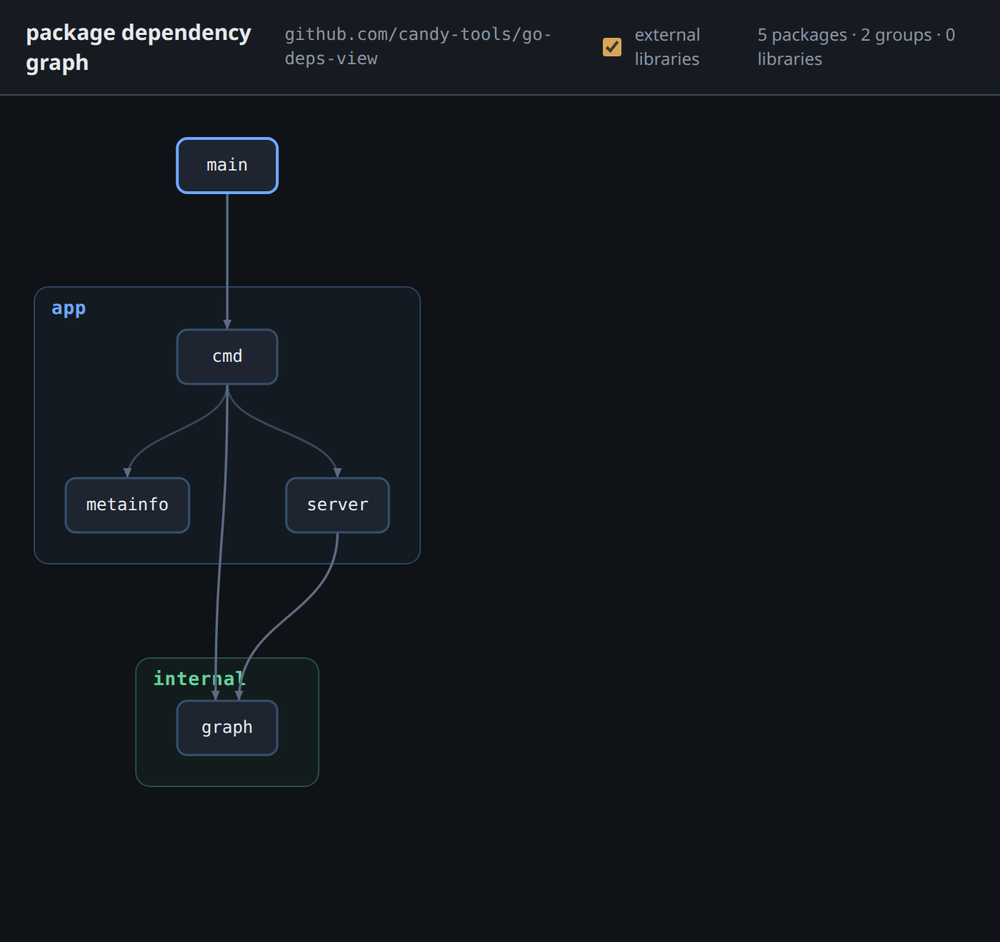

# go-deps-view

View a graphical representation of a Go module's package dependencies in the
browser: the entrypoint at the top, packages grouped into nested folder boxes,
arrows following the imports, and the external libraries off to the side.

It shells out to `go list -deps -json ./...` in the target module and serves the
graph to a small, dependency-free browser viewer that is embedded in the binary.
All grouping and layout is derived from the package paths and their imports,
optionally steered by a [layers config](#layers-config).



> **Requires the Go toolchain on `PATH`.** The graph is built by running
> `go list` against the target module on each request.

## Install

```sh
go install github.com/candy-tools/go-deps-view@latest
```

Tagged releases also publish prebuilt binaries for Linux and macOS (amd64 / arm64):

- **Archives** — download a `go-deps-view_<OS>_<arch>.tar.gz` from the
  [releases page](https://github.com/candy-tools/go-deps-view/releases).
- **Homebrew (macOS)** — `brew install --cask candy-tools/tap/go-deps-view`.
- **Debian/Ubuntu** — download the `.deb` from the releases page and
  `sudo dpkg -i go-deps-view_*.deb`.

## Usage

Run it against the current module, or point it at another with `-dir`:

```sh
go-deps-view                       # scan ., serve on http://localhost:8099
go-deps-view -dir /path/to/module  # scan another module
go-deps-view -addr :9000           # different port
go-deps-view -exclude /testdata,/mocks
go-deps-view -json                 # print the graph JSON and exit (no server)
go-deps-view -init                 # write a commented config template and exit
go-deps-view -version              # print version information and exit
```

From a checkout you can run it straight from source with `go run .` in place of
the installed binary. Stop the server with `Ctrl-C`.

## Layers config

By default whatever imports the most ends up on top, which isn't always the real
entrypoint: a folder of examples imports everything, for instance. To define the
layers yourself, add a YAML file named `.go-deps-view.config` to the directory
being scanned. `go-deps-view -init` creates one holding only comments: a guide to
filling it in, written so an agent can follow it, and an example. It never overwrites
an existing file.

```yaml
# Layers, top first.
layers:
  - name: Entry point
    description: What consumers import first
    entrypoint: true
    packages: [search]

  - name: Features
    packages: [tagging]

  - name: Core
    packages: ["*"]   # everything not listed; the quotes are required

  - name: Support
    description: Examples and test helpers
    packages: [zarf, langaitest]
```

| Key | Required | Meaning |
|---|---|---|
| `packages` | yes | Folder or package paths relative to the scanned directory. A folder covers everything inside it, `.` is the root package, and `"*"` is everything not listed. |
| `name` | no | The layer's label in the gutter left of the graph. |
| `description` | no | Text shown under the name, wrapped to fit the gutter. |
| `entrypoint` | no | Gives the layer's packages the accent border that programs have. A folder entry marks every package inside it. |

- Without a `"*"` entry, unlisted packages go below all the layers.
- Inside a layer, importers still sit above what they import. An import that goes
  against the configured order is drawn as an arrow pointing up.
- Layers order items that share a parent folder, and a folder box is never split.
  Listing `tagging/storetest` positions it inside the `tagging` box, relative to its
  siblings there. Only layers holding top-level items get a band.
- Layers show as alternating background bands split by a solid line, with their text
  in a gutter left of the graph. A band grows if its text needs the room. Bands mark
  the configured layout, so they stay put when you drag packages, and packages can't
  be dragged over the gutter.
- Each layer's gutter text has a **hide** / **show** button that toggles every package
  in the layer, including nested packages listed under it. A layer listing only nested
  paths has no band, so it has no button.
- Invalid YAML shows as an error on the page. Unknown keys are ignored, so a
  misspelled one silently does nothing. An entry that matches no package only prints
  a warning on stderr.

Notes about a package don't go in this file: write a `README.md` (or `README.markdown`
or `README`, in any case) in the package's folder, and the package gets an **i**
button that shows it, rendered as markdown. Raw HTML in it is left out. The README at
the module root describes the project, so the root package never gets the button. An
`info` key left in an older config is ignored.

The top-level `hidden` key lists what starts toggled off, as if clicked until hidden:

```yaml
hidden:
  - internal/mocks              # a package
  - examples                    # a folder covers everything inside it
  - github.com/stretchr/testify # a library, by its module path
```

**show all** and clicking bring them back until the page is reloaded. Entries that
match nothing print a warning on stderr too.

The top-level `support` key flags code that only exists to support or verify the rest,
like a `cachetest` package that checks implementations of an interface, test helpers,
fakes or examples. It takes the same entries as `hidden`:

```yaml
support:
  - internal/cache/cachetest  # a package
  - internal/testutil         # a folder covers everything inside it
```

Unchecking the **support packages** checkbox takes them out of the graph, along with
their arrows and the libraries only they import, and lays out the rest without them.

The file is read on every request, so reload the page to see an edit. To remove
packages from the graph altogether, use `-exclude` instead.

## What you see

- **Folder boxes** — the viewer builds a folder tree from the package paths and
  draws each folder as a nested box (`./internal/model/foo` → a `foo` node in a
  `model` box in an `internal` box). A folder holding just one package collapses
  into a label such as `internal/store`.
- **Layers** — an importer sits above what it imports, so programs end up at the
  top and foundation packages at the bottom, unless a
  [layers config](#layers-config) says otherwise. Programs (`package main`) get an
  accent border.
- **Import arrows** connect individual packages and route around the packages in
  their way, avoiding unrelated folders where they can. Edges crossing a top-level
  folder use a distinct colour.
- **Transitive imports** — an import already implied by a longer path is hidden
  until you hover one of its packages. Turn on the **transitive imports** checkbox
  to see them all, drawn dashed.
- **Libraries** — external dependency modules imported directly by the project
  sit on the right, toggled by the **external libraries** checkbox (standard-library
  imports are always excluded). With a [layers config](#layers-config) a vertical line
  cuts them off from the bands into a column at the window's right edge, only as wide
  as they need, since they belong to no layer; without one they sit in a box. Each sits
  level with the packages importing it, and its arrows appear on hover.
- **Support packages** — with a [`support` config](#layers-config), the **support
  packages** checkbox shows or removes the packages and libraries flagged there.
- **Click to cycle** — clicking a package or library rotates it through highlighted
  (the hover look stays on: all its arrows lit and unrelated nodes dimmed, with the
  box itself amber), hidden (greyed out with no arrows), and back to normal. Several
  nodes can be highlighted at once. **show all** brings back everything hidden. **hide
  all** only affects packages and clears their highlights.
- **Info button** — a package with a README in its folder has an **i** button that
  shows the README, rendered as markdown, in a dialog.
- **Loupe** — the magnifying glass on a package expands it to list its exported
  symbols, and imports of it split into one arrow per symbol the importer references.
  Hover a symbol to see only who references it, or hover a package to see which symbols
  it references. The other packages move aside but keep their order. The first expand
  type checks the module, so it can take a moment; the result lasts until you reload.
  - A long signature is cut off; its tooltip has the rest.
  - Arrows to an expanded package show even if the import is transitive, and stay dashed.
  - A blank import references no symbol, so it stays a single arrow to the package.
  - Only references from packages that import the symbol's package directly count. A
    symbol with no arrows may still be reached through a value from another package, or
    from tests, so it isn't necessarily unused.
- Hover a node to highlight its neighbours and the edges touching it. Arrows to what
  it imports turn blue and arrows from whatever imports it turn coral, as the key in
  the header shows. A library is only ever imported, so its arrows are all coral.
- **Drag to rearrange** — drag a package or library to move it on its own, or drag
  a box to move everything inside it together. Boxes re-wrap around their contents
  and arrows follow. The libraries' column is not a box, so it stays put and its
  libraries move one at a time. The arrangement lasts until the page is reloaded.

## JSON output (`-json`)

```json
{
  "module": "example.com/mod",
  "nodes": [
    { "id": ".",         "pkg": "example.com/mod",         "name": "main", "readme": true,  "hidden": false, "support": false },
    { "id": "./app/cmd", "pkg": "example.com/mod/app/cmd", "name": "cmd",  "readme": false, "hidden": false, "support": false }
  ],
  "edges":    [{ "from": ".", "to": "./app/cmd" }],
  "libs":     [{ "id": "github.com/gorilla/mux", "label": "gorilla/mux", "hidden": true, "support": false }],
  "libEdges": [{ "from": ".", "to": "github.com/gorilla/mux" }],
  "layers": [
    { "name": "Entry", "description": "", "entrypoint": true, "packages": ["./app/cmd"] },
    { "name": "", "description": "", "entrypoint": false, "packages": ["*"] }
  ]
}
```

- `nodes` — in-module packages; `id` is the module-relative path (`.` is the module
  root), `name` the package clause name (`main` for a program), `readme` whether its
  folder has a README, `hidden` whether the config starts it toggled off, and `support`
  whether the config flags it as support code.
- `edges` — `from imports to` (project package → project package).
- `libs` — external dependency modules; `id` is the module path, `label` the
  shortened display name, and `hidden` and `support` as for nodes.
- `libEdges` — `package imports library`.
- `layers` — the configured layers, top first; `packages` entries are in `id` form,
  plus `*`.

Empty collections are emitted as `[]` (never `null`), and standard-library
imports are excluded.

While the server runs, `/symbols.json` serves the data behind the loupe:

```json
{
  "packages": [
    { "id": "./store", "symbols": [
      { "name": "New",        "signature": "func New(c Config) *Store" },
      { "name": "Store",      "signature": "type Store struct" },
      { "name": "Store.Get",  "signature": "func (*Store).Get(id string) (model.Item, error)" }
    ] }
  ],
  "uses": [{ "from": "./server", "to": "./store", "symbol": "Store.Get" }]
}
```

## Project layout

- `main.go` — thin entrypoint.
- `app/cmd` — flag parsing (`-dir`, `-addr`, `-exclude`, `-json`, `-init`, `-version`) and dispatch.
- `app/server` — the HTTP handlers and the embedded, dependency-free viewer (`index.html`).
- `internal/graph` — the graph builder (shells out to `go list`), the symbols builder
  (type checks the module), and their JSON models.
- `app/metainfo` — build/version metadata stamped in at release time.

## Development

```sh
make verify   # test + license-check + lint + benchmark + coverage (the full gate)
make run      # build + serve on http://localhost:8099 (DIR=/path to scan elsewhere)
make build    # goreleaser snapshot build → ./dist
```

Agent-facing notes live in [`docs/agents/`](docs/agents/) and [`AGENTS.md`](AGENTS.md);
releases are cut with `make tag version="vX.Y.Z"` (see
[`docs/agents/releasing.md`](docs/agents/releasing.md)).
