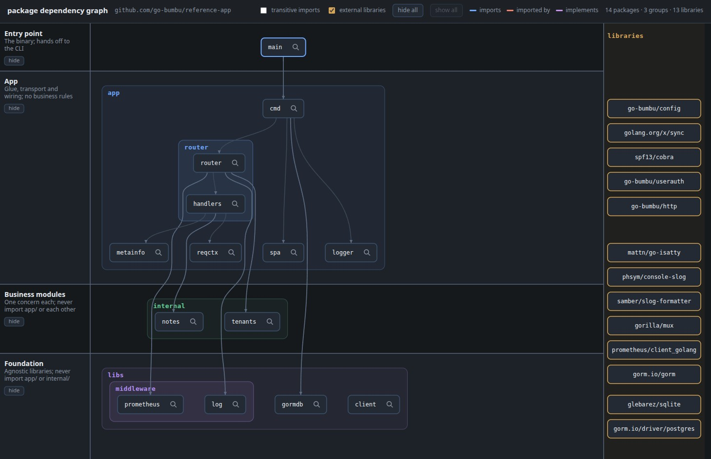

# go-deps-view

go-deps-view draws a Go module's package dependency graph in your browser: packages
in nested folder boxes, arrows following the imports, and the external libraries off
to the side.



> **Needs Go on `PATH`.** The graph is rebuilt with `go list` on every page load.

## Features

- See how a module's packages depend on each other, from the entrypoint down
- Sort packages into named layers and spot imports that point the wrong way
- Expand a package to see which of its exported symbols other packages use
- Find which packages implement a package's interfaces, even ones that never import it
- Hide test helpers, mocks or examples to focus on the code that matters
- Export the graph as JSON for your own tooling

## Install

```sh
go install github.com/candy-tools/go-deps-view@latest
```

Also available from Homebrew (`brew install --cask candy-tools/tap/go-deps-view`), the
[candy-tools APT repo](https://github.com/candy-tools/debian-repo), and as archives on
the [releases page](https://github.com/candy-tools/go-deps-view/releases).

## Quick start

```sh
cd /path/to/your/module
go-deps-view
```

Open <http://localhost:8099>. To define your own layers, run `go-deps-view -init` and
fill in the `.go-deps-view.config` it writes.

- [Usage](docs/usage.md): flags and what the viewer shows
- [Configuration](docs/config.md): layers, hidden and support packages, package READMEs
- [JSON output](docs/json.md): the `-json` and `/symbols.json` formats

## Development

See [DEVELOPMENT.md](DEVELOPMENT.md).

Licensed under the [GNU GPL v3](LICENSE).
